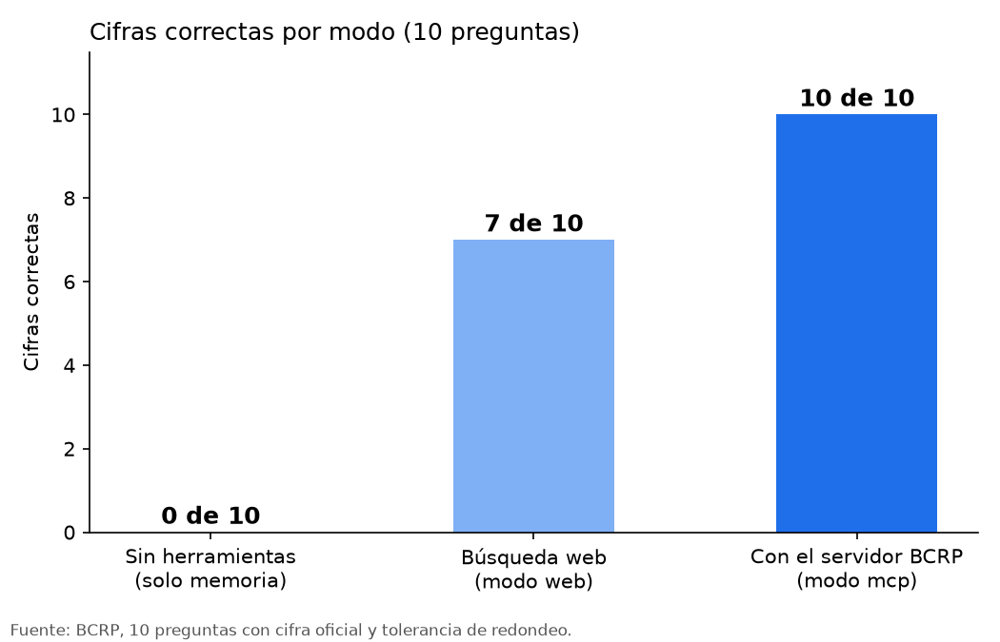

# Informe · Claude con las series oficiales del BCRP

## 1. Pregunta del experimento

¿Cuántas cifras económicas acierta Claude sin herramientas, cuántas con una búsqueda web y cuántas con un servidor MCP que consulta las series oficiales del Banco Central de Reserva del Perú (BCRP)?

## 2. Método

- **Servidor:** `server.py`, con FastMCP. Ofrece buscar series, obtener valores, calcular resúmenes, medir correlaciones, una ficha por serie y un prompt de informe. Las pruebas automáticas (`test_server.py`) pasan 8 de 8.
- **Preguntas:** 10 (`preguntas.csv`). Ocho vienen con la cifra oficial del enunciado; dos las agregamos nosotros (crédito del sistema bancario en mayo de 2026 y tasa de desempleo de Lima en agosto de 2026).
- **Modos:**
  - `memoria`: Claude responde sin herramientas.
  - `web`: Claude puede buscar y leer páginas en internet (WebSearch y WebFetch).
  - `mcp`: Claude responde con el servidor BCRP conectado.
- **Modelo:** Haiku, con `claude -p`. Cada respuesta debía dar un valor numérico y su fuente.
- **Calificación:** una respuesta acierta si su valor está dentro de la tolerancia de redondeo de cada pregunta; si Claude responde `null`, cuenta como "no sabe".

## 3. Resultados

| Modo | Acierta | Se equivoca | No sabe | Segundos promedio |
|---|---|---|---|---|
| Sin herramientas (`memoria`) | 0 | 0 | 10 | 4.5 |
| Búsqueda web (`web`) | 7 | 0 | 3 | 19.6 |
| Con el servidor BCRP (`mcp`) | 10 | 0 | 0 | 9.0 |

Detalle por pregunta (`resultados.csv`):

| Pregunta | Cifra oficial | `memoria` | `web` | `mcp` |
|---|---|---|---|---|
| IPC Lima, setiembre 2026 (12 meses) | 4.5487 % | no sabe | no sabe | acierta (4.55) |
| IPC Lima, diciembre 2025 (12 meses) | 1.5088 % | no sabe | acierta (1.51) | acierta (1.51) |
| IPC Lima, marzo 2025 (mensual) | 0.8102 % | no sabe | acierta (0.81) | acierta (0.81) |
| Tasa de referencia, setiembre 2026 | 4.25 % | no sabe | acierta (4.25) | acierta (4.25) |
| Tipo de cambio, 15 de octubre 2026 | 3.4282 S/ por US$ | no sabe | acierta (3.428) | acierta (3.428) |
| Reservas internacionales netas, agosto 2026 | 96 517.9 millones US$ | no sabe | acierta (96 518) | acierta (96 517.9) |
| Precio del cobre, agosto 2026 | 689.70 centavos US$/lb | no sabe | no sabe | acierta (689.70) |
| PBI real, 2025 | 3.4306 % | no sabe | acierta (3.44) | acierta (3.43) |
| Crédito bancario en soles, mayo 2026 | 295 907.25 millones S/ | no sabe | acierta (295 907) | acierta (295 907.25) |
| Desempleo Lima, agosto 2026 | 4.8038 % | no sabe | no sabe | acierta (4.80) |

## 4. Qué falló y por qué

- **Sin herramientas:** Claude declaró en las 10 preguntas que no tenía acceso a internet ni a datos del BCRP, y que su conocimiento llegaba hasta junio de 2026. No estimó ninguna cifra. Eso es honesto, pero no sirve para un informe.
- **Búsqueda web:** no encontró el dato en tres preguntas. En setiembre de 2026 halló el 4.55 % en una nota de prensa, pero no lo dio por bueno porque no era una fuente oficial. En cobre y desempleo no encontró publicaciones del BCRP con esas cifras. Varias respuestas correctas se apoyan en prensa o en el INEI citado por medios, no en la serie del BCRP.
- **Servidor BCRP, crédito, primeras corridas:** Claude se equivocó dos veces con la misma cifra (337 251.68). La causa: la pregunta decía "moneda nacional", pero el catálogo escribe "MN", así que `buscar_series` no encontraba nada y Claude amplió la búsqueda hasta una serie distinta (crédito directo del sistema financiero).

## 5. Cambio realizado y su efecto

Para corregir la causa, `buscar_series` ahora entiende "moneda nacional" como "MN" y "moneda extranjera" como "ME", y las siglas cortas se buscan como palabra completa. Después del cambio, las 8 pruebas siguen en verde y el modo `mcp` acertó las 10 preguntas, incluida la del crédito, usando la serie correcta `PN00522MM`.

Advertencia: esta corrida corrige el caso, pero no prueba que el servidor nunca vaya a equivocarse. Sigue sin filtrar por frecuencia: la búsqueda puede devolver una serie anual cuando la pregunta pide un mes (lo vimos con `PD09936MA`).

## 6. Dos cifras comprobadas en la web del BCRP

Las cifras de la tabla salen de la API oficial del BCRP (`estadisticas.bcrp.gob.pe/estadisticas/series/api`). Para cumplir la consigna, las comprobamos directamente en la página web de BCRPData el 28 de octubre de 2026:

- **Cifra 1:** inflación de 12 meses de Lima en setiembre de 2026 = **4.55 %**. Serie `PN01273PM`. Enlace: https://estadisticas.bcrp.gob.pe/estadisticas/series/mensuales/resultados/PN01273PM/html/2025-10/2026-09 . Coincide con la API.
- **Cifra 2:** crédito del sistema bancario al sector privado en moneda nacional, mayo de 2026 = **295 907 millones de soles** (la web muestra cifras en millones redondeadas). Serie `PN00522MM`. Enlace: https://estadisticas.bcrp.gob.pe/estadisticas/series/mensuales/resultados/PN00522MM/html/2026-01/2026-06 . Coincide con la API (295 907.25).

## 7. Conclusión

- **Sin herramientas no sirve** para cifras recientes: 0 de 10, y sin estimaciones falsas.
- **La búsqueda web es prudente:** 7 de 10 sin ningún error. Pero tarda el doble que el servidor, deja preguntas sin respuesta y a veces usa fuentes secundarias.
- **El servidor BCRP acertó 10 de 10** en esta corrida, siempre desde la fuente oficial y con código y periodo, y es más rápido (9.0 s frente a 19.6 s). Antes del ajuste de la búsqueda se equivocó en el crédito, así que su precisión depende de que la pregunta use los nombres del catálogo.

Un MCP vale la pena cuando la misma fuente se consulta muchas veces, cuando hace falta cruzar series o cuando el resultado debe citarse con su código y su periodo. Para una sola cifra puntual, la búsqueda web puede bastar. Antes de construir un servidor, conviene mirar si la fuente ya tiene API.

## 8. Limitaciones

- Diez preguntas y pocas corridas por modo. El resultado indica una tendencia, no una medición precisa.
- Se usó Haiku; con otro modelo los resultados pueden cambiar.
- La búsqueda web depende de lo que esté publicado en internet en el momento de la prueba.
- El BCRP limita las consultas seguidas, así que algunas respuestas pueden depender de reintentos.
- `buscar_series` no filtra por frecuencia todavía; una pregunta mensual puede recibir una serie anual.
- Las dos preguntas que agregamos aún deben comprobarse en la web del BCRP.
